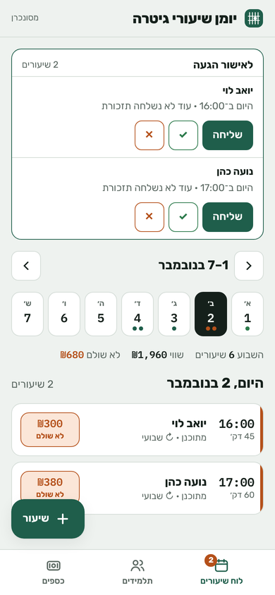
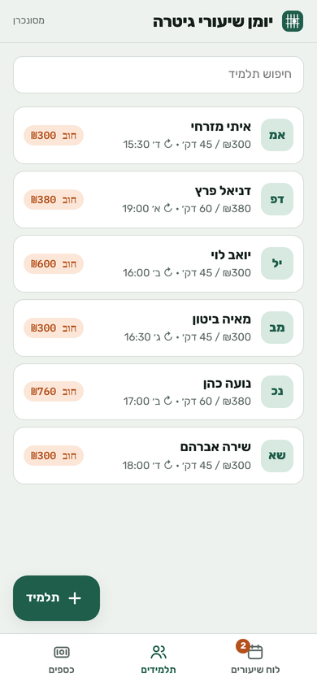
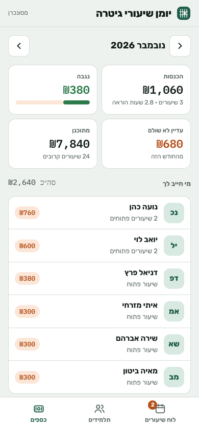

# Guitar Lessons Journal

A Hebrew (RTL) mobile web app I built and use every day to run my private guitar teaching: students, weekly lesson slots, attendance, payments and debts.

*(Screenshots use made-up demo data.)*

## Features
- **Weekly slots → lessons:** each student has a recurring day/time; lessons are generated 8 weeks ahead, and changing a slot moves only the future lessons nobody has touched.
- **Attendance & money:** confirm or cancel each lesson, record partial payments (cash / Bit / transfer), extra charges and old debts; per-student balance and a monthly income view (received, expected, unpaid).
- **Offline-first:** the whole app is one `index.html`. It keeps a local copy and syncs to the server when online, so it works in a basement studio with no signal.
- **Phone notifications:** server-side **Web Push** (VAPID + aes128gcm, written with PHP's openssl only, no libraries) triggered by a cron job — reminders the evening before and the morning of each lesson.
- **Installable:** PWA manifest + service worker; installs on Android like a native app.
- **WhatsApp shortcuts:** prefilled reminder and payment messages per student.

## Architecture
| Part | What it does |
|---|---|
| `public/index.html` | The entire UI and sync logic, vanilla JS, no framework or build step |
| `public/api.php` | Small JSON API: one password (`password_hash`), random tokens, file locking, atomic writes, 60 days of daily backups. Data lives in `public/data/`, which is blocked from the web and not in git |
| `public/push-lib.php` | Web Push encryption (RFC 8291) and VAPID signing (RFC 8292) |
| `public/cron.php` | Runs every 15 minutes and sends due reminders |
| `.github/workflows/deploy.yml` | Every push to `main` deploys `public/` over FTPS (secrets `FTP_SERVER`, `FTP_USERNAME`, `FTP_PASSWORD`) |

## Run it
Any PHP 8 host. Locally: `cd public && php -S localhost:8000`, open the page and choose a password. For reminders add a cron entry: `*/15 * * * * php /path/to/public/cron.php`.

Built with AI coding tools under my direction; I plan, review and own every change.

— Shlomi Stern · bsfstern@gmail.com · [portfolio](https://ben214.github.io/)
